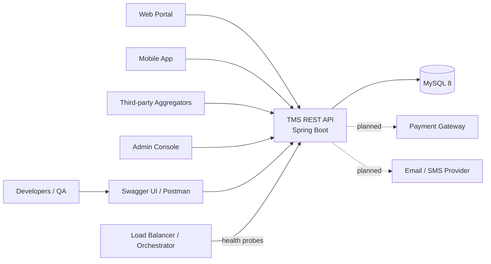
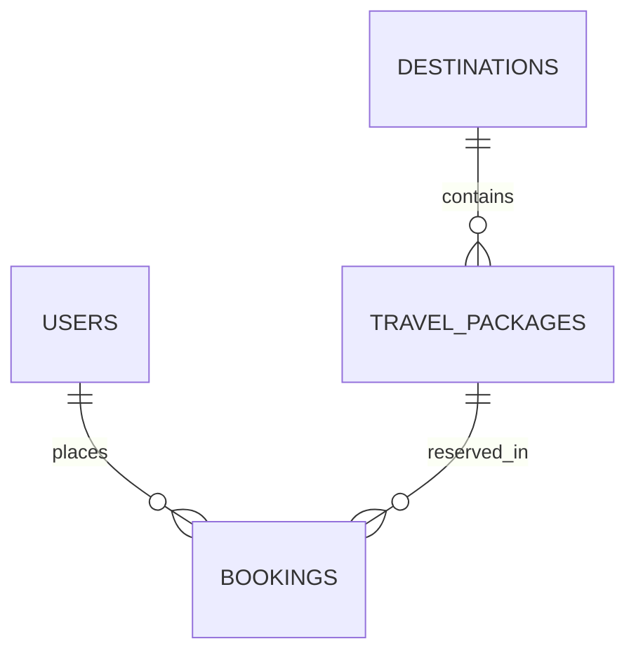
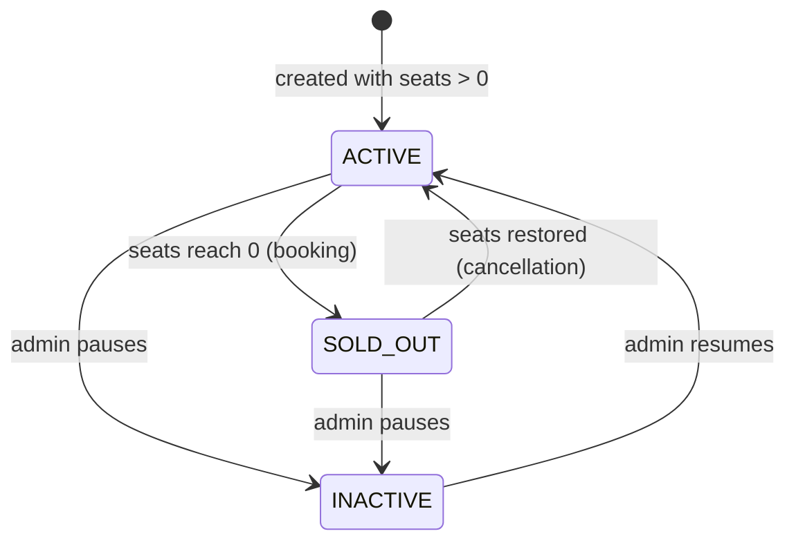
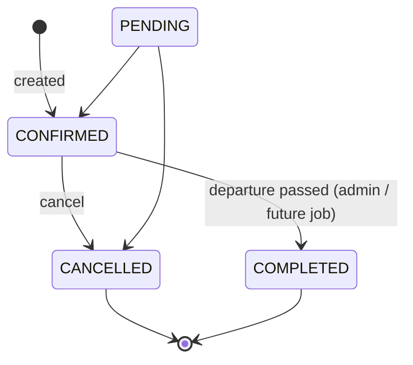
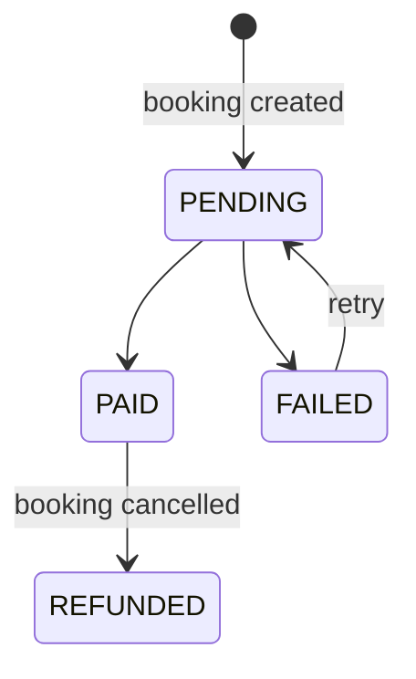
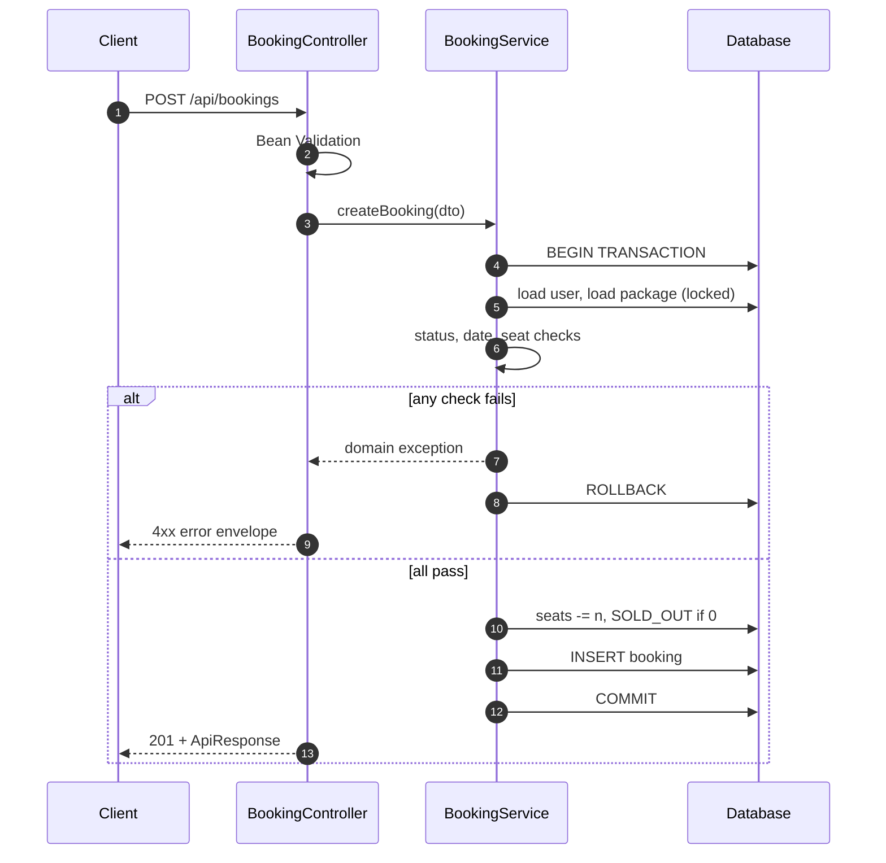

# Product Requirements Document

## Travel & Tourism Management System (TMS) — REST API

| | |
| :--- | :--- |
| **Document ID** | TMS-PRD-001 |
| **Version** | 1.0 (Draft for review) |
| **Status** | Under review |
| **Date** | 2026-10-03 |
| **Owner** | Aryan Sonawane |
| **Service** | `travel-management-system` v1.0.0 |
| **Audience** | Backend engineers, QA, frontend/mobile integrators, DevOps, product stakeholders |

### Revision History

| Version | Date | Author | Summary |
| :--- | :--- | :--- | :--- |
| 0.1 | 2026-10-03 | A. Sonawane | Initial requirements draft |
| 1.0 | 2026-10-03 | A. Sonawane | Restructured: traceable requirement IDs, state models, measurable NFRs, risk register, open questions |

### How to Read This Document

- **FR-xx / BR-xx / NFR-xx** are stable requirement IDs. Reference them in tickets, PRs and test names.
- Priority uses **MoSCoW**: **M**ust, **S**hould, **C**ould, **W**on't (this release).
- Items marked **`[Decision needed]`** are ambiguities that must be resolved before the related work is signed off. They are consolidated in [Section 14](#14-open-questions--decisions-required).
- Section 15 lists inconsistencies found while consolidating the earlier draft, so nothing is silently changed.

---

## Table of Contents

1. [Executive Summary](#1-executive-summary)
2. [Goals, Non-Goals and Success Metrics](#2-goals-non-goals-and-success-metrics)
3. [Stakeholders and Personas](#3-stakeholders-and-personas)
4. [Scope](#4-scope)
5. [Domain Model and Glossary](#5-domain-model-and-glossary)
6. [Functional Requirements](#6-functional-requirements)
7. [Business Rules and State Models](#7-business-rules-and-state-models)
8. [API Contract](#8-api-contract)
9. [Non-Functional Requirements](#9-non-functional-requirements)
10. [System Architecture and Data Design](#10-system-architecture-and-data-design)
11. [Quality Strategy and Acceptance Criteria](#11-quality-strategy-and-acceptance-criteria)
12. [Risks and Mitigations](#12-risks-and-mitigations)
13. [Assumptions, Constraints and Dependencies](#13-assumptions-constraints-and-dependencies)
14. [Open Questions and Decisions Required](#14-open-questions--decisions-required)
15. [Source Document Review Findings](#15-source-document-review-findings)
16. [Roadmap](#16-roadmap)
17. [Appendices](#17-appendices)

---

## 1. Executive Summary

### 1.1 Problem Statement

Travel booking is an inventory problem disguised as a catalog problem. The hard part is not listing trips; it is guaranteeing that a finite number of seats on a dated departure is never sold twice, and that capacity returns to the pool correctly when customers cancel. Systems that get this wrong oversell departures, issue manual refunds, and lose customer trust.

### 1.2 Product Description

TMS is a **headless, backend-only REST API** that provides:

- A destination catalog and travel package (itinerary) catalog
- Multi-criteria package discovery (price, duration, destination, status, keyword)
- Transactional booking with **overbooking prevention** and **automatic seat restoration** on cancellation
- User account management with role segregation (`USER`, `ADMIN`)
- Operational health endpoints and interactive API documentation

It is designed as the foundation for a web booking portal, a mobile app, or third-party tourism aggregators.

### 1.3 Technology Baseline

Java 21, Spring Boot 3.3.4, Spring Data JPA / Hibernate 6.5, MySQL 8.x (production) / H2 (test), HikariCP, Jakarta Bean Validation, Lombok, Springdoc OpenAPI 2.6.0, JUnit 5, Mockito, AssertJ, Maven 3.9+.

### 1.4 Current Maturity

| Area | State |
| :--- | :--- |
| Catalog, booking and inventory workflows | Implemented |
| Validation, error envelope, API docs, Postman collection | Implemented |
| Automated tests | 28 passing (unit, service, context smoke) |
| **Authentication / authorization** | **Not implemented** (see R-01) |
| **Payment processing** | **Modelled only**, no gateway (see R-06) |
| Notifications | Not implemented |

---

## 2. Goals, Non-Goals and Success Metrics

### 2.1 Goals

| ID | Goal |
| :--- | :--- |
| G-1 | Guarantee that confirmed seats for any package never exceed its capacity, even under concurrent requests. |
| G-2 | Guarantee that cancellations restore capacity exactly once and keep package status consistent with seat count. |
| G-3 | Let consumers discover packages through composable filters with predictable pagination and sorting. |
| G-4 | Provide a stable, self-documenting, consistently-shaped HTTP contract suitable for multiple client types. |
| G-5 | Keep business rules in one layer (Service), testable without HTTP or a database server. |

### 2.2 Non-Goals (This Release)

- Authentication, authorization, session management (planned, see Roadmap)
- Real payment capture, refunds through a gateway, or PCI scope
- Email/SMS notifications
- Multi-currency pricing and tax/fee calculation
- Itinerary day-by-day structure (itinerary is free text via `inclusions`, `exclusions`, `description`)
- Reviews, ratings, recommendations
- Multi-tenant or multi-supplier marketplace features
- A user interface (only Swagger UI is provided)

### 2.3 Success Metrics

| Metric | Target | How measured |
| :--- | :--- | :--- |
| Oversell incidents (`confirmed seats > capacity`) | **0** | Concurrency integration test (see TC-CONC-01), production reconciliation query |
| Seat-count drift after N book/cancel cycles | **0** | Invariant test (see TC-INV-01) |
| Filter endpoint p95 latency, 10k packages | ≤ 300 ms | Load test |
| Booking endpoint p95 latency | ≤ 400 ms at 50 concurrent users | Load test |
| Unit/service test line coverage on `service` package | ≥ 85% | JaCoCo (proposed) |
| Error responses conforming to the documented envelope | 100% | Contract test |

---

## 3. Stakeholders and Personas

| Persona | Role | Primary needs |
| :--- | :--- | :--- |
| **Traveler** | End customer via a web/mobile client | Find a trip within budget and dates, book it, see history, cancel |
| **Administrator** | Operations staff | Maintain catalog, adjust capacity and price, view passenger rosters, correct booking/payment state |
| **Frontend / Mobile Developer** | API consumer | Predictable contract, clear errors, pagination, Swagger |
| **QA Engineer** | Verification | Deterministic H2 profile, Postman collection, documented rules with IDs |
| **DevOps / SRE** | Operations | Health endpoints, env-based configuration, stateless service |
| **Product Owner** | Stakeholder | Roadmap clarity, risk visibility |

---

## 4. Scope

### 4.1 In Scope

Users, Destinations, Travel Packages, Bookings, search/filter, seat inventory, cancellation and refund-state transition, error handling, OpenAPI docs, Actuator health/info.

### 4.2 Out of Scope

See [2.2](#22-non-goals-this-release).

### 4.3 Context Diagram



---

## 5. Domain Model and Glossary

### 5.1 Glossary

| Term | Definition |
| :--- | :--- |
| **Destination** | A geographic place a customer can travel to (e.g. Bali). |
| **Travel Package** | A sellable, dated departure to one destination with a fixed price per traveler and a finite seat quota. |
| **Seat** | One traveler's place on a package departure. One traveler consumes exactly one seat. |
| **Available Seats** | Seats not currently held by a non-cancelled booking. |
| **Booking** | A reservation of N seats on one package by one user. |
| **Overbooking** | Total seats held by non-cancelled bookings exceeding package capacity. Must never occur. |
| **Seat Restoration** | Returning a cancelled booking's seats to the package's available pool. |
| **DTO** | Data Transfer Object; the only shape exposed over HTTP. |

### 5.2 Entity Relationships



### 5.3 Core Invariants

These must hold at every committed transaction boundary:

| ID | Invariant |
| :--- | :--- |
| INV-1 | `0 ≤ package.availableSeats` |
| INV-2 | `availableSeats == 0` ⇔ package status is `SOLD_OUT`, unless the package is `INACTIVE` `[Decision needed: D-03]` |
| INV-3 | `booking.totalAmount == booking.packagePrice × booking.numberOfTravelers` (scale 2) |
| INV-4 | A booking in `CANCELLED` has returned its seats exactly once. |
| INV-5 | `package.endDate ≥ package.startDate` |
| INV-6 | User `email` unique (case-normalised); Destination `name` unique. |
| INV-7 | No response DTO exposes a password or credential field. |

---

## 6. Functional Requirements

### 6.1 User Management

| ID | Requirement | Priority |
| :--- | :--- | :---: |
| FR-U1 | The system shall register a user from `name`, `email`, `phone`, `password` and optional `role` (`USER` or `ADMIN`, default `USER`). | M |
| FR-U2 | Registration shall be rejected with **409** if the normalised email already exists. | M |
| FR-U3 | The system shall validate `name` and `email` as `@NotBlank`, `email` as `@Email`, and `password` length 6–50. | M |
| FR-U4 | The system shall return a user profile by ID, never including credentials. | M |
| FR-U5 | The system shall return a paginated, sortable user list (`page`, `size`, `sortBy`, `sortDir`). | M |
| FR-U6 | The system shall update a user's name, phone, credentials; changing email to one already registered by another user shall be rejected with **409**. | M |
| FR-U7 | The system shall delete a user. Behaviour when the user has bookings is defined by **D-01**. | M |

### 6.2 Destination Management

| ID | Requirement | Priority |
| :--- | :--- | :---: |
| FR-D1 | The system shall create a destination with `name`, `country`, `state`, `description`, `bestTimeToVisit`, `imageUrl`. | M |
| FR-D2 | Destination `name` shall be unique; duplicates rejected with **409**. | M |
| FR-D3 | The system shall support get-by-ID, paginated list, update and delete. | M |
| FR-D4 | `GET /api/destinations/search` shall perform case-insensitive matching on `name`, `country` and `state`. | M |
| FR-D5 | Deleting a destination that still has packages is governed by **D-02**. | M |

### 6.3 Travel Package Management

| ID | Requirement | Priority |
| :--- | :--- | :---: |
| FR-P1 | The system shall create a package linked to an existing destination; unknown destination → **404**. | M |
| FR-P2 | `endDate` shall be on or after `startDate`; otherwise **400**. | M |
| FR-P3 | `price` shall be positive (`BigDecimal`); `availableSeats` shall be ≥ 0. | M |
| FR-P4 | The system shall support get-by-ID (full itinerary details), paginated list, update, delete. | M |
| FR-P5 | The system shall list packages by destination. | M |
| FR-P6 | The system shall list "available" packages: status `ACTIVE` **and** `availableSeats > 0`. | M |
| FR-P7 | Package responses shall include denormalised `destinationName` and `destinationCountry` to avoid client round-trips. | S |
| FR-P8 | Reducing `availableSeats` via update to 0 or raising it from 0 shall trigger status reconciliation per **D-03**. | M |

### 6.4 Search and Filtering

`GET /api/packages/filter` shall accept any combination of the following, combined with logical AND. Omitted parameters impose no constraint.

| ID | Parameter | Semantics |
| :--- | :--- | :--- |
| FR-S1 | `destinationId` | Exact match on destination |
| FR-S2 | `minPrice`, `maxPrice` | Inclusive price bounds |
| FR-S3 | `minDuration`, `maxDuration` | Inclusive duration bounds in days |
| FR-S4 | `status` | One of `ACTIVE`, `INACTIVE`, `SOLD_OUT` (the **package** status) |
| FR-S5 | `keyword` | Case-insensitive substring on package name, destination name, destination country |
| FR-S6 | `page`, `size`, `sortBy`, `sortDir` | Pagination and sorting; defaults per [8.4](#84-pagination-and-sorting) |

Requirement FR-S7 (**M**): `minPrice > maxPrice` or `minDuration > maxDuration` shall return **400**, not an empty page.

### 6.5 Booking

| ID | Requirement | Priority |
| :--- | :--- | :---: |
| FR-B1 | The system shall create a booking from `userId`, `travelPackageId`, `numberOfTravelers` (≥ 1). | M |
| FR-B2 | Unknown user or package → **404**. | M |
| FR-B3 | Package status `INACTIVE` or `SOLD_OUT` → **400** (`InvalidBookingException`). | M |
| FR-B4 | Package `startDate` in the past → **400** (`InvalidBookingException`). | M |
| FR-B5 | `numberOfTravelers > availableSeats` → **400** (`InsufficientSeatsException`) with a message stating requested and available counts. | M |
| FR-B6 | On success, within a single transaction the system shall: decrement seats, set `SOLD_OUT` if seats reach 0, compute `totalAmount`, persist the booking with `CONFIRMED` / `PENDING`. | M |
| FR-B7 | The system shall retrieve a booking by ID, list all (paginated), list by user, list by package. | M |
| FR-B8 | The system shall allow updating booking status, payment status and traveler count via `PUT /api/bookings/{id}`. Seat and amount consequences are defined in **BR-B6**. | M |
| FR-B9 | The system shall cancel a booking via `DELETE /api/bookings/{id}` and `PUT /api/bookings/{id}/cancel` with identical behaviour. | M |
| FR-B10 | Cancelling an already `CANCELLED` booking → **400**. | M |
| FR-B11 | The booking response shall snapshot `packagePrice` at booking time. Later price changes shall not alter existing bookings. | M |

### 6.6 Cross-Cutting

| ID | Requirement | Priority |
| :--- | :--- | :---: |
| FR-X1 | All successful responses shall use the `ApiResponse` envelope; paginated data shall use `PageResponse`. | M |
| FR-X2 | All failures shall use the error envelope in [8.3](#83-error-contract). | M |
| FR-X3 | OpenAPI 3.0 documentation shall be served at `/v3/api-docs` and `/swagger-ui/index.html`. | M |
| FR-X4 | `/actuator/health` and `/actuator/info` shall be exposed. | M |
| FR-X5 | Demo data seeding (`DataInitializer`) shall be disabled or guarded outside local/demo profiles `[Decision needed: D-07]`. | S |
| FR-X6 | CORS shall be configurable per environment (`WebConfig`). | S |

---

## 7. Business Rules and State Models

### 7.1 Package Status



Rule: automatic transitions (`ACTIVE ⇄ SOLD_OUT`) never override an admin-set `INACTIVE`. `[Decision needed: D-03]` specifies what happens to an `INACTIVE` package whose seats reach zero or are restored.

### 7.2 Booking Status



`CANCELLED` and `COMPLETED` are terminal. Any update attempting to leave a terminal state shall return **400** (**BR-B5**). `[Decision needed: D-04]` confirms whether `PENDING` is ever an initial state, since creation currently yields `CONFIRMED`.

### 7.3 Payment Status



### 7.4 Booking Rules

| ID | Rule |
| :--- | :--- |
| BR-B1 | Validation order is fixed: user exists → package exists → package status → departure date → seat sufficiency. This makes error responses deterministic and testable. |
| BR-B2 | `totalAmount = packagePrice × numberOfTravelers`, `BigDecimal`, scale 2, `RoundingMode.HALF_UP`. |
| BR-B3 | Seat decrement and booking insert are **one atomic unit**; failure of either rolls back both. |
| BR-B4 | **Cancellation** shall, in one transaction: add `numberOfTravelers` to `availableSeats`; if package is `SOLD_OUT` and seats > 0 set `ACTIVE`; set booking `CANCELLED`; if `paymentStatus == PAID` set `REFUNDED`. |
| BR-B5 | `CANCELLED` and `COMPLETED` bookings are immutable except for read access. |
| BR-B6 | **Traveler-count update** on an active booking: the delta `(new − old)` shall be applied to package seats with the same sufficiency check as creation; `totalAmount` shall be recomputed from the stored `packagePrice` snapshot; package status reconciled. `[Decision needed: D-05]` confirms this is in scope for v1.0. |
| BR-B7 | Restoration is idempotent-by-state: a second cancel attempt fails (FR-B10) and cannot restore seats twice (INV-4). |
| BR-B8 | A refund transition applies only when `paymentStatus == PAID`. A `PENDING` or `FAILED` payment remains unchanged on cancellation. See finding F-04. |

### 7.5 Concurrency Rule

| ID | Rule |
| :--- | :--- |
| BR-C1 | Two concurrent bookings for the last seat shall result in exactly one success and one **400** insufficient-seats failure. |
| BR-C2 | The implementation shall use **one** documented strategy, chosen under **D-06**: (a) pessimistic row lock (`SELECT … FOR UPDATE`) on the package row, (b) conditional atomic update `UPDATE … SET available_seats = available_seats - :n WHERE id = :id AND available_seats >= :n` with affected-row check, or (c) optimistic locking with `@Version` and bounded retry. |
| BR-C3 | Cancellation and booking against the same package shall use the same strategy so they serialize correctly. |

### 7.6 Validation Summary

| Field | Constraint |
| :--- | :--- |
| `user.name` | not blank |
| `user.email` | not blank, valid email, unique |
| `user.password` | 6–50 characters |
| `user.role` | `USER` or `ADMIN`, default `USER` |
| `destination.name` | not blank, unique |
| `package.price` | positive, scale 2 |
| `package.availableSeats` | ≥ 0 |
| `package.duration` | positive integer (days) |
| `package.startDate` / `endDate` | `endDate ≥ startDate` |
| `booking.numberOfTravelers` | ≥ 1 |

---

## 8. API Contract

**Base URL:** `http://localhost:8081` · **Media type:** `application/json` · **Auth:** none in v1.0

### 8.1 Endpoints

#### Users

| Method | Path | Request | Success | Errors |
| :--- | :--- | :--- | :---: | :--- |
| POST | `/api/users` | `UserRequestDTO` | 201 | 400, 409 |
| GET | `/api/users/{id}` | — | 200 | 404 |
| GET | `/api/users` | query: paging | 200 | 400 |
| PUT | `/api/users/{id}` | `UserRequestDTO` | 200 | 400, 404, 409 |
| DELETE | `/api/users/{id}` | — | 204 | 404, 409* |

#### Destinations

| Method | Path | Request | Success | Errors |
| :--- | :--- | :--- | :---: | :--- |
| POST | `/api/destinations` | `DestinationRequestDTO` | 201 | 400, 409 |
| GET | `/api/destinations/{id}` | — | 200 | 404 |
| GET | `/api/destinations` | query: paging | 200 | 400 |
| PUT | `/api/destinations/{id}` | `DestinationRequestDTO` | 200 | 400, 404, 409 |
| DELETE | `/api/destinations/{id}` | — | 204 | 404, 409* |
| GET | `/api/destinations/search` | query: `query` + paging | 200 | 400 |

#### Packages

| Method | Path | Request | Success | Errors |
| :--- | :--- | :--- | :---: | :--- |
| POST | `/api/packages` | `TravelPackageRequestDTO` | 201 | 400, 404 |
| GET | `/api/packages/{id}` | — | 200 | 404 |
| GET | `/api/packages` | query: paging | 200 | 400 |
| PUT | `/api/packages/{id}` | `TravelPackageRequestDTO` | 200 | 400, 404 |
| DELETE | `/api/packages/{id}` | — | 204 | 404, 409* |
| GET | `/api/packages/filter` | query: see 6.4 | 200 | 400 |
| GET | `/api/packages/destination/{id}` | — | 200 | 404 |
| GET | `/api/packages/available` | query: paging | 200 | 400 |

#### Bookings

| Method | Path | Request | Success | Errors |
| :--- | :--- | :--- | :---: | :--- |
| POST | `/api/bookings` | `BookingRequestDTO` | 201 | 400, 404 |
| GET | `/api/bookings/{id}` | — | 200 | 404 |
| GET | `/api/bookings` | query: paging | 200 | 400 |
| GET | `/api/bookings/user/{userId}` | — | 200 | 404 |
| GET | `/api/bookings/package/{pkgId}` | — | 200 | 404 |
| PUT | `/api/bookings/{id}` | `BookingStatusUpdateDTO` | 200 | 400, 404 |
| DELETE | `/api/bookings/{id}` | — | 200 | 400, 404 |
| PUT | `/api/bookings/{id}/cancel` | — | 200 | 400, 404 |

\* 409 on delete applies only if **D-01 / D-02** choose "block deletion when dependents exist".

#### Operations

| Method | Path | Purpose |
| :--- | :--- | :--- |
| GET | `/actuator/health` | Liveness/readiness probe |
| GET | `/actuator/info` | Build and version info |
| GET | `/v3/api-docs` | OpenAPI JSON |
| GET | `/swagger-ui/index.html` | Interactive docs |

> **Design note:** `DELETE /api/bookings/{id}` performs a *state transition* (cancel), not a physical delete, and returns **200** with a body rather than **204**. This is a deliberate, documented deviation from REST convention; `PUT /{id}/cancel` is the semantically preferred form. New clients should use it. See finding F-05.

### 8.2 Response Envelope

**Success**

```json
{
  "success": true,
  "message": "Booking created successfully",
  "data": { },
  "timestamp": "2026-10-03T15:20:00"
}
```

**Paginated `data`**

```json
{
  "content": [ ],
  "pageNumber": 0,
  "pageSize": 10,
  "totalElements": 1,
  "totalPages": 1,
  "isLast": true
}
```

### 8.3 Error Contract

All errors share one shape. `validationErrors` is present only for field-validation failures.

```json
{
  "timestamp": "2026-10-03T15:21:00",
  "status": 400,
  "error": "Insufficient Seats",
  "message": "Requested 50 seats, but only 18 seats are available.",
  "path": "/api/bookings"
}
```

```json
{
  "timestamp": "2026-10-03T15:22:00",
  "status": 400,
  "error": "Validation Failed",
  "message": "Request validation failed",
  "path": "/api/users",
  "validationErrors": {
    "email": "must be a well-formed email address",
    "password": "size must be between 6 and 50"
  }
}
```

| Exception | HTTP | `error` label |
| :--- | :---: | :--- |
| `ResourceNotFoundException` | 404 | Not Found |
| `DuplicateResourceException` | 409 | Conflict |
| `BadRequestException` | 400 | Bad Request |
| `InvalidBookingException` | 400 | Invalid Booking |
| `InsufficientSeatsException` | 400 | Insufficient Seats |
| `BookingException` | 400 | Booking Failed |
| `MethodArgumentNotValidException` | 400 | Validation Failed |
| Uncaught `Exception` | 500 | Internal Server Error (no stack trace, no internals in `message`) |

### 8.4 Pagination and Sorting

| Parameter | Default | Constraint |
| :--- | :--- | :--- |
| `page` | 0 | ≥ 0, zero-based |
| `size` | 10 | 1–100; larger values clamp to 100 `[Decision needed: D-08]` |
| `sortBy` | `id` | Must be an allow-listed property; unknown → **400** (never pass raw input to `Sort`) |
| `sortDir` | `asc` | `asc` or `desc`, case-insensitive |

### 8.5 Worked Examples

**Create booking**

```http
POST /api/bookings
Content-Type: application/json

{ "userId": 2, "travelPackageId": 1, "numberOfTravelers": 2 }
```

```json
{
  "success": true,
  "message": "Booking created successfully",
  "data": {
    "id": 1,
    "userId": 2,
    "userName": "Alice Johnson",
    "userEmail": "alice@travel.com",
    "travelPackageId": 1,
    "packageName": "Exotic Bali 7-Day Adventure",
    "destinationName": "Bali",
    "bookingDate": "2026-10-03T15:20:00",
    "numberOfTravelers": 2,
    "packagePrice": 899.99,
    "totalAmount": 1799.98,
    "bookingStatus": "CONFIRMED",
    "paymentStatus": "PENDING",
    "createdAt": "2026-10-03T15:20:00",
    "updatedAt": "2026-10-03T15:20:00"
  },
  "timestamp": "2026-10-03T15:20:00"
}
```

**Booking sequence**



---

## 9. Non-Functional Requirements

### 9.1 Performance and Capacity

| ID | Requirement | Target |
| :--- | :--- | :--- |
| NFR-P1 | Read endpoints (single resource) p95 | ≤ 150 ms |
| NFR-P2 | `/api/packages/filter` p95 with 10k packages | ≤ 300 ms |
| NFR-P3 | `POST /api/bookings` p95 at 50 concurrent users | ≤ 400 ms |
| NFR-P4 | HikariCP: max pool 10, min idle 5, connection timeout 20 000 ms | As configured |
| NFR-P5 | List endpoints shall never return unbounded results (paging enforced) | 100% |
| NFR-P6 | Required DB indexes: `users(email)` unique, `destinations(name)` unique, `travel_packages(destination_id)`, `travel_packages(status, start_date)`, `bookings(user_id)`, `bookings(package_id)` | Present |

### 9.2 Reliability and Data Integrity

| ID | Requirement |
| :--- | :--- |
| NFR-R1 | Booking and cancellation are atomic (BR-B3, BR-B4). |
| NFR-R2 | Money uses `BigDecimal`, scale 2, `HALF_UP`; no `double`/`float` anywhere in the money path. |
| NFR-R3 | Service is stateless; any instance can serve any request (horizontal scaling ready). |
| NFR-R4 | Graceful shutdown enabled so in-flight bookings complete. |
| NFR-R5 | Schema changes in non-local environments shall be applied by migrations (Flyway/Liquibase), not `ddl-auto: update`. See R-05. |

### 9.3 Security

| ID | Requirement | Release |
| :--- | :--- | :---: |
| NFR-S1 | Passwords shall never appear in any response, log line, or exception message. | v1.0 |
| NFR-S2 | Passwords shall be stored using an adaptive hash (BCrypt, cost ≥ 10). **Confirm current behaviour; see R-01.** | v1.0 |
| NFR-S3 | No stack traces or SQL fragments in error responses. | v1.0 |
| NFR-S4 | `sortBy` allow-listing to prevent property-probing and injection through sort parameters. | v1.0 |
| NFR-S5 | Secrets (DB credentials) via environment variables, never committed. | v1.0 |
| NFR-S6 | JWT authentication; `ADMIN`-only for catalog mutation and cross-user booking access; users limited to their own bookings. | v1.1 |
| NFR-S7 | Rate limiting on write endpoints. | v1.2 |
| NFR-S8 | Actuator exposure limited to `health` and `info` in non-local profiles. | v1.0 |

> **Important:** until NFR-S6 ships, every endpoint, including user deletion and booking by arbitrary `userId`, is publicly callable. The service must not be exposed to untrusted networks in this state.

### 9.4 Observability

| ID | Requirement |
| :--- | :--- |
| NFR-O1 | Structured logs with a per-request correlation ID returned in an `X-Request-Id` header. |
| NFR-O2 | Business event logs at INFO: booking created, booking cancelled, package sold out (IDs only, no PII). |
| NFR-O3 | Metrics via Actuator/Micrometer: request latency, error rate, bookings created, seat-conflict count. |
| NFR-O4 | Health endpoint includes database connectivity. |

### 9.5 Persistence and Environments

| Profile | Database | Schema management | Purpose |
| :--- | :--- | :--- | :--- |
| `mysql` (default) | MySQL 8.x, `travel_tourism_db` | `ddl-auto: update` (local only) | Development and demo |
| `h2` / `test` | H2 in `MODE=MySQL` | `create-drop` | CI and tests, zero external dependencies |
| `prod` (proposed) | MySQL 8.x | Migrations, `ddl-auto: validate` | Production |

Profile naming is inconsistent across earlier documents (`h2` vs `test`); see F-02.

### 9.6 Maintainability

| ID | Requirement |
| :--- | :--- |
| NFR-M1 | Controllers contain no business logic. |
| NFR-M2 | Entities are never serialized to clients; mappers are the only conversion point. |
| NFR-M3 | New business rules require a unit test referencing the rule ID in its display name. |
| NFR-M4 | Public API changes follow semantic versioning and are recorded in a changelog. |

### 9.7 Compatibility and Portability

Java 21 LTS, MySQL 8.0+, runs on any OS with a JVM; containerizable (Docker image is a roadmap item).

---

## 10. System Architecture and Data Design

### 10.1 Layered Architecture

```text
Client
  │ HTTP / JSON
  ▼
Controller   (HTTP mapping, @Valid, status codes)           ← no business logic
  ▼
Service      (business rules, @Transactional)               ← single source of truth
  ▼
Mapper       (Entity ↔ DTO)
  ▼
Repository   (Spring Data JPA, derived + @Query/Specification)
  ▼
MySQL / H2
```

Cross-cutting: `GlobalExceptionHandler` (`@RestControllerAdvice`), `OpenApiConfig`, `WebConfig` (CORS), `DataInitializer`.

### 10.2 Package Layout

`config`, `controller`, `dto`, `entity`, `enums`, `exception`, `mapper`, `repository`, `service` under `com.travel.management`.

### 10.3 Data Model

| Table | Key columns | Constraints |
| :--- | :--- | :--- |
| `users` | `id`, `name`, `email`, `phone`, `password`, `role`, `created_at`, `updated_at` | `email` UNIQUE |
| `destinations` | `id`, `name`, `country`, `state`, `description`, `best_time_to_visit`, `image_url`, `created_at` | `name` UNIQUE |
| `travel_packages` | `id`, `destination_id`, `package_name`, `description`, `duration`, `price`, `available_seats`, `start_date`, `end_date`, `inclusions`, `exclusions`, `status`, `created_at`, `updated_at` | FK → destinations; `CHECK (available_seats >= 0)`; `CHECK (end_date >= start_date)` (proposed) |
| `bookings` | `id`, `user_id`, `package_id`, `booking_date`, `number_of_travelers`, `total_amount`, `booking_status`, `payment_status`, `created_at`, `updated_at` | FKs → users, travel_packages; **needs a `package_price` snapshot column to satisfy FR-B11 if not already present** |

The database-level `CHECK` on `available_seats` is a last line of defence behind the application logic, so a concurrency bug surfaces as a failed transaction rather than silent oversell.

### 10.4 Client Contract Types (TypeScript)

```typescript
export type UserRole = "USER" | "ADMIN";
export type PackageStatus = "ACTIVE" | "INACTIVE" | "SOLD_OUT";
export type BookingStatus = "CONFIRMED" | "PENDING" | "CANCELLED" | "COMPLETED";
export type PaymentStatus = "PENDING" | "PAID" | "FAILED" | "REFUNDED";

export interface ApiResponse<T> {
  success: boolean;
  message: string;
  data: T;
  timestamp: string;            // ISO-8601, server local time (see A-02)
}

export interface PageResponse<T> {
  content: T[];
  pageNumber: number;           // zero-based
  pageSize: number;
  totalElements: number;
  totalPages: number;
  isLast: boolean;
}

export interface ApiError {
  timestamp: string;
  status: number;
  error: string;
  message: string;
  path: string;
  validationErrors?: Record<string, string>;
}

export interface User {
  id: number; name: string; email: string; phone: string;
  role: UserRole; createdAt: string; updatedAt: string;
}

export interface Destination {
  id: number; name: string; country: string; state: string;
  description?: string; bestTimeToVisit?: string; imageUrl?: string;
  createdAt: string;
}

export interface TravelPackage {
  id: number; packageName: string;
  destinationId: number; destinationName?: string; destinationCountry?: string;
  description?: string;
  duration: number;             // days
  price: number;                // per traveler, currency per A-01
  availableSeats: number;
  startDate: string;            // YYYY-MM-DD
  endDate: string;              // YYYY-MM-DD
  inclusions?: string; exclusions?: string;
  status: PackageStatus; createdAt: string; updatedAt: string;
}

export interface Booking {
  id: number;
  userId: number; userName?: string; userEmail?: string;
  travelPackageId: number; packageName?: string; destinationName?: string;
  bookingDate: string;
  numberOfTravelers: number;
  packagePrice: number;         // snapshot at booking time
  totalAmount: number;
  bookingStatus: BookingStatus; paymentStatus: PaymentStatus;
  createdAt: string; updatedAt: string;
}
```

> Money is shown as `number` for readability. Clients that do arithmetic should treat amounts as decimal strings or integer minor units to avoid binary floating-point error.

---

## 11. Quality Strategy and Acceptance Criteria

### 11.1 Test Pyramid

| Level | Tooling | Scope |
| :--- | :--- | :--- |
| Unit / service | JUnit 5, Mockito, AssertJ | Every business rule (BR-*), validators, mappers |
| Repository slice | `@DataJpaTest` + H2 | Filter queries, uniqueness, constraints |
| Web slice | `@WebMvcTest` | Status codes, validation messages, error envelope |
| Integration | `@SpringBootTest` | Full flows incl. **concurrency** |
| Contract | OpenAPI snapshot diff | Detect accidental API breaks |
| Non-functional | k6/JMeter (proposed) | NFR-P targets |

### 11.2 Acceptance Criteria (Given / When / Then)

**AC-1 Successful booking decrements seats**

- Given package 1 is `ACTIVE` with 10 seats at 899.99
- When user 2 books 2 travelers
- Then response is 201, `totalAmount` is 1799.98, status `CONFIRMED`/`PENDING`, and package 1 has 8 seats

**AC-2 Last seat triggers SOLD_OUT**

- Given a package with 2 seats
- When a booking for 2 travelers succeeds
- Then package status is `SOLD_OUT` and seats are 0

**AC-3 Overbooking is rejected**

- Given a package with 18 seats
- When a booking for 50 travelers is requested
- Then response is 400, error `Insufficient Seats`, message states requested 50 and available 18, and seats remain 18

**AC-4 Cancellation restores inventory**

- Given a `SOLD_OUT` package whose only booking holds 2 seats with payment `PAID`
- When the booking is cancelled
- Then seats are 2, package is `ACTIVE`, booking is `CANCELLED`, payment is `REFUNDED`

**AC-5 Double cancellation is rejected**

- Given a `CANCELLED` booking
- When cancel is called again
- Then response is 400 and package seats are unchanged

**AC-6 Departed package cannot be booked**

- Given a package whose `startDate` is yesterday
- When anyone books it
- Then response is 400 `InvalidBookingException`

**AC-7 Duplicate email**

- Given a user with `a@x.com`
- When another registration uses `A@X.com`
- Then response is 409

**AC-8 Filter semantics**

- Given 3 packages priced 400, 900, 1900
- When `minPrice=500&maxPrice=2000` is requested
- Then exactly the 900 and 1900 packages are returned, paginated

**AC-9 Invalid range**

- When `minPrice=2000&maxPrice=500`
- Then response is 400 (FR-S7)

**AC-10 No credential leakage**

- For every user-returning endpoint, the JSON contains no `password` key.

### 11.3 Concurrency Test Cases

| ID | Scenario | Pass condition |
| :--- | :--- | :--- |
| TC-CONC-01 | 20 threads each book 1 seat on a package with 5 seats | Exactly 5 succeed, 15 fail with insufficient seats, final seats = 0, status `SOLD_OUT` |
| TC-CONC-02 | Simultaneous cancel + book on the last seat | Final state consistent with INV-1..INV-4 |
| TC-INV-01 | 1 000 randomized book/cancel operations | `capacity − Σ(active booking travelers) == availableSeats` at end |

### 11.4 Definition of Done (per requirement)

1. Implemented in the correct layer
2. Unit test referencing the requirement ID
3. Error paths covered
4. OpenAPI annotations updated
5. Postman collection updated
6. README / changelog updated
7. No new warnings; build green on H2 profile

---

## 12. Risks and Mitigations

| ID | Risk | Likelihood | Impact | Mitigation |
| :--- | :--- | :---: | :---: | :--- |
| R-01 | **No authentication/authorization**: any caller can read/modify/delete any resource or book on behalf of any user; plaintext password storage is possible if hashing is not yet implemented | High | **Critical** | Verify and enforce BCrypt now (NFR-S2); ship JWT + RBAC in v1.1; do not expose publicly before then |
| R-02 | Race condition oversells a departure | Medium | High | Choose and test one locking strategy (BR-C2); DB `CHECK` constraint; TC-CONC-01 in CI |
| R-03 | Seat/amount drift when booking is edited (traveler-count update) | Medium | High | Define BR-B6 precisely, test invariants (TC-INV-01), or defer the feature (D-05) |
| R-04 | Unbounded or unsafe `sortBy` / page size | Medium | Medium | Allow-list properties, clamp `size` (8.4) |
| R-05 | `ddl-auto: update` causes undetected schema drift in shared environments | Medium | High | Adopt Flyway; `validate` in prod |
| R-06 | Payment status is a manually-edited field with no gateway truth; `REFUNDED` can be set without money moving | High | Medium | Document as non-authoritative until gateway integration; restrict updates to `ADMIN` in v1.1 |
| R-07 | Demo seed data runs in a real environment | Low | Medium | Guard `DataInitializer` by profile (FR-X5) |
| R-08 | Time-zone ambiguity around "start date in the past" | Medium | Medium | Set JVM/JDBC to UTC explicitly; inject `Clock` for testability (A-02) |
| R-09 | Orphaned or inconsistent data on deleting users/destinations/packages with bookings | Medium | High | Resolve D-01/D-02; prefer soft-delete or block-with-409 |
| R-10 | Contract drift between README, PRD, Swagger and Postman | Medium | Low | OpenAPI is the source of truth; contract snapshot test |

---

## 13. Assumptions, Constraints and Dependencies

### Assumptions

| ID | Assumption |
| :--- | :--- |
| A-01 | A single currency is used for all prices. The earlier draft assumes USD. Confirm before any regional launch. |
| A-02 | Timestamps use the server clock. They are only UTC if the JVM and JDBC `serverTimezone` are explicitly set to UTC. Treat this as a configuration requirement, not an assumption (R-08). |
| A-03 | One traveler consumes exactly one seat. |
| A-04 | Package capacity equals seats at creation; there is no separate immutable `capacity` field (affects INV and TC-INV-01 reconciliation; consider adding `totalSeats`). |
| A-05 | Bookings are not tied to named traveler records (only a count). |

### Constraints

Single-service deployment, relational database as the only persistent store, synchronous request/response only.

### Dependencies

MySQL 8.x (prod), JDK 21, Maven Central, and (future) a payment gateway and a notification provider.

---

## 14. Open Questions & Decisions Required

| ID | Question | Options | Recommended | Owner |
| :--- | :--- | :--- | :--- | :--- |
| D-01 | What happens when a **user with bookings** is deleted? | (a) block with 409 (b) cascade-delete bookings (c) soft-delete user | **(c) soft-delete**, preserves financial history | Product + Eng |
| D-02 | What happens when a **destination/package with dependents** is deleted? | block with 409 / cascade / soft-delete | **Block with 409** for packages with non-cancelled bookings; soft-delete otherwise | Product + Eng |
| D-03 | How do automatic `SOLD_OUT`/`ACTIVE` transitions interact with admin-set `INACTIVE`, and with seat edits via `PUT /packages`? | auto overrides / auto never overrides `INACTIVE` | **Auto transitions never override `INACTIVE`**; seat edits run the same reconciliation | Eng |
| D-04 | Is `PENDING` booking status ever an initial state (e.g. awaiting payment)? | yes / no | **No for v1.0** (creation → `CONFIRMED`); revisit with payment gateway | Product |
| D-05 | Is changing `numberOfTravelers` on an existing booking in v1.0 scope? | in scope (BR-B6) / defer | **Defer**: cancel and rebook is safer until concurrency tests are in place | Product + Eng |
| D-06 | Which concurrency strategy (BR-C2)? | pessimistic lock / atomic conditional UPDATE / optimistic `@Version` | **Atomic conditional UPDATE** (simplest, fewest locks held, easy to test) | Eng |
| D-07 | Should seed data run outside `h2`/local profiles? | yes / no | **No** | Eng |
| D-08 | Maximum page size? | 50 / 100 / unbounded | **100, clamp** | Eng |
| D-09 | Should cancelling a `PENDING` payment ever produce `REFUNDED`? | yes / no | **No**, only `PAID` → `REFUNDED` (BR-B8) | Product |
| D-10 | Allow booking packages that depart *today*? | yes / no | **Yes** (past = strictly before today); define cut-off time later | Product |

---

## 15. Source Document Review Findings

The earlier draft was reviewed while preparing this version. These items were corrected, clarified, or escalated here rather than copied forward.

| ID | Finding in earlier material | Resolution in this PRD |
| :--- | :--- | :--- |
| F-01 | Error envelope was described as **RFC 7807-compliant**, but the documented fields (`timestamp`, `status`, `error`, `message`, `path`) are Spring Boot's classic error shape, not RFC 7807 Problem Details (`type`, `title`, `status`, `detail`, `instance`). | Documented as a custom envelope (8.3). Adopting `application/problem+json` is a candidate future change. |
| F-02 | Test profile is called `test` in one document and `h2` in the README/run instructions. | Both listed in 9.5; **pick one name** and update docs. |
| F-03 | Feature list said filters include "booking status"; the filter actually applies to **package** status. | Corrected in FR-S4. |
| F-04 | Cancel example in the README showed `paymentStatus: REFUNDED` for a booking created with `PENDING` payment, while the requirements say refund occurs only if `PAID`. | Rule fixed as BR-B8 / D-09; **README example should be corrected** to show `PAID → REFUNDED` or leave `PENDING` unchanged. |
| F-05 | `DELETE` is used for cancellation (state change, returns 200 with body). | Documented as intentional (8.1 note); `PUT /cancel` preferred. |
| F-06 | "Pessimistic/atomic updates" was stated without choosing a strategy. | Made an explicit decision (D-06, BR-C2). |
| F-07 | Departure-date rule appeared for booking but the README implied it for package creation too. | Package creation date rule is only `endDate ≥ startDate` (FR-P2). Whether past `startDate` is allowed at creation is **not** specified; flagged for confirmation. |
| F-08 | "Cascades cleanly" on user deletion was undefined. | Replaced by decision D-01. |
| F-09 | "Standardized to UTC" for `LocalDateTime.now()` is not true by default. | Reframed as a configuration requirement (A-02, R-08). |
| F-10 | Destination search parameter is `query`, package filter uses `keyword`. | Kept as-is for compatibility; noted in 8.1. Consider aligning in v1.1. |
| F-11 | No price snapshot was specified, but `packagePrice` is returned on bookings. | Elevated to FR-B11 and a data-model check (10.3). |
| F-12 | Authentication is absent while `ADMIN`/`USER` roles are described, which implies enforcement that does not exist. | Called out prominently (R-01, NFR-S6). |

---

## 16. Roadmap

| Release | Theme | Key deliverables |
| :--- | :--- | :--- |
| **v1.0** (current) | Core platform | Catalog, filtering, transactional booking, cancellation, docs, tests. Close D-01…D-10; BCrypt verified; concurrency tests; `sortBy` allow-list; `CHECK` constraints. |
| **v1.1** | Security | Spring Security + JWT, RBAC (`ADMIN` vs `USER`), ownership checks on bookings, audit fields (`createdBy`). |
| **v1.2** | Production readiness | Flyway migrations, `prod` profile, Dockerfile + docker-compose, correlation IDs, Micrometer metrics, rate limiting, GitHub Actions CI. |
| **v1.3** | Payments | Gateway integration (Stripe/PayPal/Razorpay), webhooks, authoritative payment state, real refunds, `PENDING` booking flow. |
| **v1.4** | Engagement | Email/SMS notifications (event-driven), reviews and ratings. |
| **v2.0** | Platform | Recommendations, multi-currency, supplier/partner model, API versioning (`/api/v2`). |

---

## 17. Appendices

### Appendix A: Requirement Traceability Matrix

| Requirement | Rule / Invariant | Endpoint | Test |
| :--- | :--- | :--- | :--- |
| FR-B1…B6 | BR-B1…B3, INV-1…3 | `POST /api/bookings` | AC-1, AC-2, AC-3, AC-6, TC-CONC-01 |
| FR-B9, B10 | BR-B4, B7, B8, INV-4 | `DELETE`/`PUT` cancel | AC-4, AC-5 |
| FR-B8 | BR-B5, BR-B6 | `PUT /api/bookings/{id}` | Pending D-05 |
| FR-S1…S7 | n/a | `GET /api/packages/filter` | AC-8, AC-9 |
| FR-U1…U3 | INV-6 | `POST /api/users` | AC-7 |
| FR-U4, NFR-S1 | INV-7 | all user endpoints | AC-10 |
| FR-P6 | INV-2 | `GET /api/packages/available` | Repository slice test |
| FR-X1, X2 | n/a | all | Web slice + contract tests |
| NFR-C* / BR-C* | INV-1 | booking, cancel | TC-CONC-01, TC-CONC-02, TC-INV-01 |

### Appendix B: Environment Variables

| Variable | Default | Description |
| :--- | :--- | :--- |
| `PORT` | `8081` | HTTP port |
| `DB_HOST` | `localhost` | MySQL host |
| `DB_PORT` | `3306` | MySQL port |
| `DB_NAME` | `travel_tourism_db` | Database name |
| `DB_USERNAME` | `root` | DB user (**override outside local dev**) |
| `DB_PASSWORD` | `root` | DB password (**override outside local dev**) |
| `SPRING_PROFILES_ACTIVE` | `mysql` | `mysql`, `h2` |

### Appendix C: HTTP Status Code Policy

| Code | Used for |
| :---: | :--- |
| 200 | Successful read/update/cancel |
| 201 | Resource created |
| 204 | Successful delete with no body |
| 400 | Validation failure, business-rule violation, malformed input |
| 404 | Referenced resource does not exist |
| 409 | Uniqueness conflict (and dependent-delete conflicts if D-01/D-02 choose blocking) |
| 500 | Unexpected server error (sanitised) |
| 401/403 | Reserved for v1.1 (authentication/authorization) |

### Appendix D: Sign-off

| Role | Name | Date | Status |
| :--- | :--- | :--- | :--- |
| Product Owner | | | Pending |
| Tech Lead | | | Pending |
| QA Lead | | | Pending |
| Security Review | | | Pending (blocked on R-01) |
