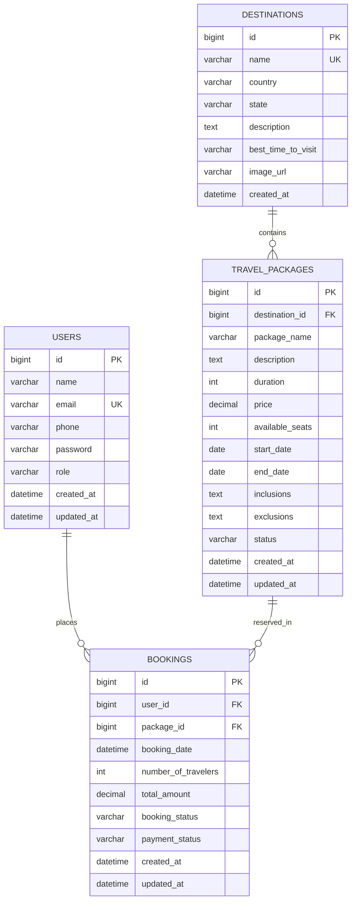

# Travel & Tourism Management System - RESTful API

A production-ready, enterprise-grade backend REST API for a **Travel & Tourism Management System** built with **Java 21, Spring Boot 3.3.4, Spring Data JPA, Hibernate, MySQL, Lombok, Jakarta Validation, and OpenAPI 3.0 (Swagger UI)**.

---

## 📌 Project Overview

The **Travel & Tourism Management System** backend enables customers to browse destinations, explore detailed travel package itineraries, filter packages by price/duration/destination, and complete bookings with real-time seat inventory tracking. It empowers administrators to manage destinations, configure vacation packages, track customer reservations, and monitor inventory.

### Key Highlights
* **Clean Layered Architecture**: Strict separation of concerns across Controller, Service, Repository, Entity, DTO, Mapper, and Exception layers.
* **Zero Entity Exposure**: All client interactions utilize dedicated Request and Response DTOs.
* **Transactional Seat Engine**: Prevents overbooking, enforces seat sufficiency, atomically updates package quotas, and restores seats upon cancellation.
* **Dynamic Search & Filtering**: Multi-parameter search queries (destination, price brackets, duration ranges, status, and free-text search).
* **Comprehensive Validation**: Declarative Jakarta validation annotations on all incoming payloads with friendly error messages.
* **Global Error Handling**: Standardized error responses across all failure modes via `@RestControllerAdvice`.
* **Interactive API Documentation**: Swagger UI / OpenAPI 3.0 interactive documentation at `http://localhost:8081/swagger-ui/index.html`.
* **Postman Collection Included**: Complete Postman v2.1 collection file ready to import and test.
* **Dual Persistence Modes**: Production-ready MySQL datasource with automatic schema management + in-memory H2 mode for deterministic test execution.

---

## 🛠️ Technology Stack

| Layer | Technology |
| :--- | :--- |
| **Language** | Java 21 (Temurin / OpenJDK) |
| **Framework** | Spring Boot 3.3.4 |
| **Web Layer** | Spring MVC (`spring-boot-starter-web`) |
| **Persistence** | Spring Data JPA, Hibernate 6.5 |
| **Database** | MySQL 8.0+ (Production) / H2 (Testing) |
| **Connection Pool** | HikariCP |
| **Validation** | Jakarta Bean Validation (`@NotBlank`, `@Min`, `@Positive`, etc.) |
| **Boilerplate Reduction**| Project Lombok 1.18.36 |
| **API Documentation** | Springdoc OpenAPI Starter 2.6.0 (Swagger UI) |
| **Testing** | JUnit 5, Mockito, Spring Boot Starter Test, AssertJ |
| **Build Tool** | Apache Maven 3.9+ |
| **Monitoring** | Spring Boot Actuator |

---

## 🏛️ Architecture

The application adheres to a clean layered architecture where business rules reside strictly within the **Service Layer**:

```text
HTTP Clients (Web / Mobile / Postman / Swagger)
                      │
                      ▼
               [ Controller Layer ]
         (User, Destination, Package, Booking)
                      │
                      ▼
                [ Service Layer ]
  (UserService, DestinationService, PackageService, BookingService)
                      │
                      ▼
               [ Repository Layer ]
 (UserRepository, DestinationRepository, PackageRepository, BookingRepository)
                      │
                      ▼
         [ Database Layer (MySQL / H2) ]
```

### Package Organization
```text
com.travel.management
├── config
│   ├── DataInitializer.java          # Seeds demo users, destinations, packages, bookings
│   ├── OpenApiConfig.java            # OpenAPI 3.0 specification & metadata
│   └── WebConfig.java                # CORS registry configuration
├── controller
│   ├── BookingController.java        # Booking lifecycle endpoints
│   ├── DestinationController.java    # Destination discovery & CRUD endpoints
│   ├── TravelPackageController.java  # Package itinerary, filter & CRUD endpoints
│   └── UserController.java           # User profile & registration endpoints
├── dto
│   ├── ApiResponse.java              # Generic response wrapper
│   ├── BookingRequestDTO.java        # Booking input payload
│   ├── BookingResponseDTO.java       # Booking output view
│   ├── BookingStatusUpdateDTO.java   # Booking update payload
│   ├── DestinationRequestDTO.java    # Destination input payload
│   ├── DestinationResponseDTO.java   # Destination output view
│   ├── ErrorResponse.java            # Standard error envelope
│   ├── PageResponse.java             # Generic pagination envelope
│   ├── TravelPackageRequestDTO.java  # Package input payload
│   ├── TravelPackageResponseDTO.java # Package output view
│   ├── UserRequestDTO.java           # User registration payload
│   └── UserResponseDTO.java          # User output view (excludes password)
├── entity
│   ├── Booking.java                  # Booking JPA entity
│   ├── Destination.java              # Destination JPA entity
│   ├── TravelPackage.java            # TravelPackage JPA entity
│   └── User.java                     # User JPA entity
├── enums
│   ├── BookingStatus.java            # CONFIRMED, PENDING, CANCELLED, COMPLETED
│   ├── PackageStatus.java            # ACTIVE, INACTIVE, SOLD_OUT
│   ├── PaymentStatus.java            # PENDING, PAID, FAILED, REFUNDED
│   └── UserRole.java                 # USER, ADMIN
├── exception
│   ├── BadRequestException.java      # 400 Bad Request
│   ├── BookingException.java         # 400 Booking Failure
│   ├── DuplicateResourceException.java # 409 Conflict
│   ├── GlobalExceptionHandler.java   # Centralized @RestControllerAdvice
│   ├── InsufficientSeatsException.java # 400 Insufficient Seats
│   ├── InvalidBookingException.java  # 400 Invalid Booking Logic
│   └── ResourceNotFoundException.java # 404 Not Found
├── mapper
│   ├── BookingMapper.java            # Booking Entity <-> DTO
│   ├── DestinationMapper.java        # Destination Entity <-> DTO
│   ├── TravelPackageMapper.java      # Package Entity <-> DTO
│   └── UserMapper.java               # User Entity <-> DTO
├── repository
│   ├── BookingRepository.java        # Spring Data JPA queries
│   ├── DestinationRepository.java    # Search & existence queries
│   ├── TravelPackageRepository.java  # Multi-criteria filter queries
│   └── UserRepository.java           # User lookups & uniqueness
└── TravelManagementApplication.java  # Spring Boot Main Entry Point
```

---

## 🗄️ Database Design & Entity Relationship



---

## 📋 API Endpoints Reference

Base URL: `http://localhost:8081`

### 1. User Management
| Method | Endpoint | Description | Status Code |
| :--- | :--- | :--- | :---: |
| `POST` | `/api/users` | Register a new user | `201 CREATED` |
| `GET` | `/api/users/{id}` | Retrieve user profile by ID | `200 OK` |
| `GET` | `/api/users` | Retrieve paginated users (`page`, `size`, `sortBy`, `sortDir`) | `200 OK` |
| `PUT` | `/api/users/{id}` | Update existing user details | `200 OK` |
| `DELETE` | `/api/users/{id}` | Delete user account | `204 NO CONTENT` |

### 2. Destination Management
| Method | Endpoint | Description | Status Code |
| :--- | :--- | :--- | :---: |
| `POST` | `/api/destinations` | Add a new travel destination | `201 CREATED` |
| `GET` | `/api/destinations/{id}` | Retrieve destination details by ID | `200 OK` |
| `GET` | `/api/destinations` | List all destinations with pagination | `200 OK` |
| `PUT` | `/api/destinations/{id}` | Update destination details | `200 OK` |
| `DELETE` | `/api/destinations/{id}` | Delete destination | `204 NO CONTENT` |
| `GET` | `/api/destinations/search` | Search destinations by keyword query | `200 OK` |

### 3. Travel Package Management
| Method | Endpoint | Description | Status Code |
| :--- | :--- | :--- | :---: |
| `POST` | `/api/packages` | Create a new travel package | `201 CREATED` |
| `GET` | `/api/packages/{id}` | Get package itinerary details by ID | `200 OK` |
| `GET` | `/api/packages` | List all travel packages (paginated) | `200 OK` |
| `PUT` | `/api/packages/{id}` | Update package pricing, dates, or seats | `200 OK` |
| `DELETE` | `/api/packages/{id}` | Delete travel package | `204 NO CONTENT` |
| `GET` | `/api/packages/filter` | Multi-criteria search and filter packages | `200 OK` |
| `GET` | `/api/packages/destination/{id}` | Get all packages for a destination | `200 OK` |
| `GET` | `/api/packages/available` | Get packages with status `ACTIVE` and seats > 0 | `200 OK` |

### 4. Booking Management
| Method | Endpoint | Description | Status Code |
| :--- | :--- | :--- | :---: |
| `POST` | `/api/bookings` | Book package seats (atomically decrements seats) | `201 CREATED` |
| `GET` | `/api/bookings/{id}` | Retrieve booking details by ID | `200 OK` |
| `GET` | `/api/bookings` | List all bookings with pagination | `200 OK` |
| `GET` | `/api/bookings/user/{userId}` | List all bookings placed by a user | `200 OK` |
| `GET` | `/api/bookings/package/{pkgId}` | List all bookings for a travel package | `200 OK` |
| `PUT` | `/api/bookings/{id}` | Update booking status, payment, or travelers | `200 OK` |
| `DELETE`| `/api/bookings/{id}` | Cancel booking (restores seats to package) | `200 OK` |
| `PUT` | `/api/bookings/{id}/cancel` | Cancel booking (PUT alternative endpoint) | `200 OK` |

---

## ⚙️ Configuration & Environment Variables

The application is configured through `src/main/resources/application.yml` with support for environment variables:

```yaml
spring:
  datasource:
    url: jdbc:mysql://${DB_HOST:localhost}:${DB_PORT:3306}/${DB_NAME:travel_tourism_db}?createDatabaseIfNotExist=true&useSSL=false&allowPublicKeyRetrieval=true&serverTimezone=UTC
    username: ${DB_USERNAME:root}
    password: ${DB_PASSWORD:root}
```

### Environment Variables
| Variable | Description | Default Value |
| :--- | :--- | :--- |
| `PORT` | HTTP server listening port | `8081` |
| `DB_HOST` | MySQL hostname | `localhost` |
| `DB_PORT` | MySQL port | `3306` |
| `DB_NAME` | Database schema name | `travel_tourism_db` |
| `DB_USERNAME` | MySQL database user | `root` |
| `DB_PASSWORD` | MySQL database password | `root` |
| `SPRING_PROFILES_ACTIVE` | Active profile (`mysql` or `h2`) | `mysql` |

---

## 🚀 Getting Started

### Prerequisites
* **Java 21** installed (`java -version`)
* **Maven 3.8+** installed (`mvn -version`)
* **MySQL 8.0+** running locally (or activate `h2` profile for in-memory DB)

### 1. Clone & Build
```bash
git clone https://github.com/your-username/Travel-Management-System.git
cd Travel-Management-System
mvn clean install
```

### 2. Run the Application
#### Option A: Running with MySQL (Default)
Ensure your MySQL server is running on port 3306, then:
```bash
mvn spring-boot:run
```

#### Option B: Running with In-Memory H2 Database
If you do not have MySQL installed or want quick standalone testing:
```bash
mvn spring-boot:run -Dspring-boot.run.profiles=h2
```

#### Option C: Running the Executable JAR
```bash
java -jar target/travel-management-system-1.0.0.jar
```

---

## 📖 Swagger / OpenAPI Documentation

Once the application is running, open your web browser:
* **Interactive Swagger UI**: [http://localhost:8081/swagger-ui/index.html](http://localhost:8081/swagger-ui/index.html)
* **Raw OpenAPI JSON Spec**: [http://localhost:8081/v3/api-docs](http://localhost:8081/v3/api-docs)

The Swagger UI allows real-time interactive testing of all endpoints with schema models and sample payloads.

---

## 📮 Postman Collection

A complete Postman collection is included in the project root:
* File: `Travel_Management_System_API.postman_collection.json`

### Importing into Postman:
1. Open Postman.
2. Click **Import** in the top left.
3. Select `Travel_Management_System_API.postman_collection.json`.
4. The collection is pre-configured with the `{{baseUrl}}` variable set to `http://localhost:8081`.
5. Execute requests across the 5 categorized folders:
   * `1. User Management`
   * `2. Destination Management`
   * `3. Travel Package Management`
   * `4. Booking Management`
   * `5. Actuator Health`

---

## 🧪 Testing

The project includes unit and service tests built with **JUnit 5 and Mockito**:
* **Booking Business Rules**: Verifies seat sufficiency check, atomic seat decrement, automatic `SOLD_OUT` status transitions, and seat restoration upon cancellation.
* **Date Validations**: Verifies rejection of departure dates in the past or end dates before start dates.
* **Uniqueness Constraints**: Verifies duplicate user emails and duplicate destination names are caught.
* **Context Smoke Tests**: Verifies Spring Boot application context bootstraps cleanly.

### Running Tests:
```bash
mvn test
```

Output:
```text
[INFO] Results:
[INFO] Tests run: 28, Failures: 0, Errors: 0, Skipped: 0
[INFO] BUILD SUCCESS
```

---

## 💡 Example API Requests & Responses

### 1. Register User
```bash
curl -X POST "http://localhost:8081/api/users" \
  -H "Content-Type: application/json" \
  -d '{
    "name": "Sarah Connor",
    "email": "sarah.connor@example.com",
    "phone": "+1-555-0188",
    "password": "SecurePassword@123",
    "role": "USER"
  }'
```
**Response (201 Created):**
```json
{
  "success": true,
  "message": "User registered successfully",
  "data": {
    "id": 4,
    "name": "Sarah Connor",
    "email": "sarah.connor@example.com",
    "phone": "+1-555-0188",
    "role": "USER",
    "createdAt": "2026-10-03T15:20:00",
    "updatedAt": "2026-10-03T15:20:00"
  },
  "timestamp": "2026-10-03T15:20:00"
}
```

### 2. Multi-Criteria Package Filter
```bash
curl -X GET "http://localhost:8081/api/packages/filter?minPrice=500&maxPrice=2000&minDuration=5&maxDuration=8&status=ACTIVE&keyword=Alps"
```
**Response (200 OK):**
```json
{
  "success": true,
  "message": "Filtered packages fetched successfully",
  "data": {
    "content": [
      {
        "id": 3,
        "packageName": "Majestic Swiss Alps Mountain Expedition",
        "destinationId": 3,
        "destinationName": "Swiss Alps",
        "destinationCountry": "Switzerland",
        "description": "Unforgettable Alpine journey across Zermatt, Matterhorn, and panoramic Glacier Express.",
        "duration": 6,
        "price": 1850.00,
        "availableSeats": 10,
        "startDate": "2027-01-03",
        "endDate": "2027-01-09",
        "status": "ACTIVE"
      }
    ],
    "pageNumber": 0,
    "pageSize": 10,
    "totalElements": 1,
    "totalPages": 1,
    "isLast": true
  }
}
```

### 3. Create Booking
```bash
curl -X POST "http://localhost:8081/api/bookings" \
  -H "Content-Type: application/json" \
  -d '{
    "userId": 2,
    "travelPackageId": 1,
    "numberOfTravelers": 2
  }'
```
**Response (201 Created):**
```json
{
  "success": true,
  "message": "Booking created successfully",
  "data": {
    "id": 3,
    "userId": 2,
    "userName": "Alice Johnson",
    "userEmail": "alice@travel.com",
    "travelPackageId": 1,
    "packageName": "Exotic Bali 7-Day Adventure",
    "destinationName": "Bali",
    "bookingDate": "2026-10-03T15:25:00",
    "numberOfTravelers": 2,
    "packagePrice": 899.99,
    "totalAmount": 1799.98,
    "bookingStatus": "CONFIRMED",
    "paymentStatus": "PENDING"
  }
}
```

### 4. Cancel Booking (Restores Inventory)
```bash
curl -X DELETE "http://localhost:8081/api/bookings/3"
```
**Response (200 OK):**
```json
{
  "success": true,
  "message": "Booking cancelled successfully and seats restored",
  "data": {
    "id": 3,
    "bookingStatus": "CANCELLED",
    "paymentStatus": "REFUNDED"
  }
}
```

---

## 🔮 Future Enhancements
* **Spring Security & JWT Authentication**: Adding stateless bearer token verification for fine-grained endpoint authorization.
* **Payment Gateway Webhooks**: Integrating Stripe or PayPal for instant payment settlement.
* **Automated Notifications**: Email/SMS confirmation triggers via SendGrid or Twilio.
* **Customer Reviews & Ratings**: Allowing verified travelers to submit ratings and feedback for packages.

---

## 📄 License
This project is open-source and licensed under the [Apache License 2.0](LICENSE).
