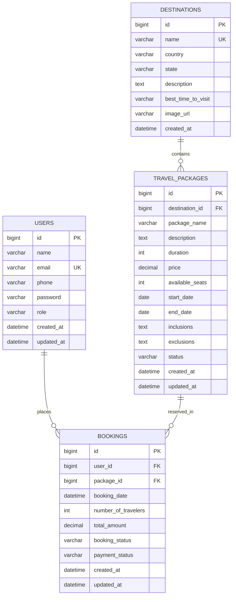

# ✈️ Travel & Tourism Management System — REST API

A production-structured RESTful backend for a travel booking platform, built with **Java 21, Spring Boot 3.3.4, Spring Data JPA, Hibernate, MySQL, Lombok, Jakarta Validation, and OpenAPI 3.0 (Swagger UI)**.

Customers can discover destinations, explore package itineraries, filter packages by price, duration and status, and book trips with **real-time seat inventory tracking**. Administrators can manage destinations, packages, users and reservations. Everything is delivered through a clean layered architecture with standardised API responses.

<br/>


---

## 📋 Table of Contents

- [What is this project?](#-what-is-this-project)
- [Tech Stack](#-tech-stack)
- [Features](#-features)
- [How it Works — Architecture](#-how-it-works--architecture)
- [Project Structure](#-project-structure)
- [Database Schema](#-database-schema)
- [API Reference](#-api-reference)
- [How to Use the API — Request and Response Examples](#-how-to-use-the-api--request-and-response-examples)
- [Business Rules and Validations](#-business-rules-and-validations)
- [DTOs — Why We Never Return Raw Entities](#-dtos--why-we-never-return-raw-entities)
- [Error Handling](#-error-handling)
- [Getting Started — Run it Locally](#-getting-started--run-it-locally)
- [Configuration Reference](#-configuration-reference)
- [Sample Data](#-sample-data)
- [Swagger / OpenAPI](#-swagger--openapi)
- [Postman Collection](#-postman-collection)
- [Testing](#-testing)
- [Roadmap](#-roadmap)
- [Author](#-author)
- [License](#-license)

---

## 🌐 What is this project?

This is a **backend REST API** — the server-side engine behind a travel booking app like MakeMyTrip, Booking.com or Expedia.

It handles everything behind the scenes:

- When a customer browses destinations or searches for a trip — this API serves the data
- When someone filters packages by budget or duration — this API runs the query
- When someone books a trip — this API checks seats, calculates the price and reserves the seats
- When someone cancels — this API restores the seats so others can book them

> **For beginners:** A REST API is a set of URLs (called *endpoints*) that a frontend app (web or mobile) calls to get or send data. This project provides all of those endpoints for a travel platform. Think of it as the kitchen of a restaurant — the customer never sees it, but every order passes through it.

### 🚀 Key Highlights

- ✅ **Clean Layered Architecture** — Controller, Service, Repository, Entity, DTO, Mapper and Exception layers with strict separation of concerns
- ✅ **Zero Entity Exposure** — Clients only ever see dedicated Request/Response DTOs, never raw JPA entities
- ✅ **Transactional Seat Engine** — Prevents overbooking, atomically updates package seats, restores seats on cancellation
- ✅ **Dynamic Search & Filtering** — Combine destination, price range, duration range, status and keyword in one request
- ✅ **Pagination & Sorting** — Available on users, destinations, packages and bookings
- ✅ **Jakarta Validation** — Declarative validation on every incoming payload with friendly messages
- ✅ **Global Exception Handling** — One `@RestControllerAdvice` returns consistent error JSON
- ✅ **Swagger UI** — Interactive OpenAPI 3.0 documentation out of the box
- ✅ **Postman Collection** — Ready-to-import v2.1 collection
- ✅ **MySQL + H2** — MySQL for normal runs, in-memory H2 for quick standalone testing
- ✅ **Spring Boot Actuator** — Health and monitoring endpoints

---

## 🛠️ Tech Stack

| Layer | Technology | What it does |
| :--- | :--- | :--- |
| Language | Java 21 (Temurin / OpenJDK) | The programming language used |
| Framework | Spring Boot 3.3.4 | Makes building Java web apps fast and easy |
| Web Layer | Spring MVC | Handles HTTP requests and responses |
| ORM | Spring Data JPA + Hibernate 6.5 | Connects Java code to the database |
| Database | MySQL 8.0+ (production) / H2 (testing) | Stores all the data |
| Connection Pool | HikariCP | Manages database connections efficiently |
| Validation | Jakarta Bean Validation | `@NotBlank`, `@Min`, `@Positive` and friends |
| Boilerplate | Project Lombok 1.18.36 | Removes getters/setters/constructors noise |
| API Docs | Springdoc OpenAPI 2.6.0 | Generates Swagger UI automatically |
| Testing | JUnit 5, Mockito, AssertJ, Spring Boot Test | Unit and service tests |
| Build Tool | Apache Maven 3.9+ | Manages dependencies and builds |
| Monitoring | Spring Boot Actuator | Health checks and app metrics |

---

## ✨ Features

### 👤 Users
- ✅ Register new users (roles: `USER`, `ADMIN`)
- ✅ Retrieve a user profile by ID
- ✅ Paginated and sortable user list (`page`, `size`, `sortBy`, `sortDir`)
- ✅ Update user details
- ✅ Delete a user account
- ✅ Unique email enforcement
- ✅ Password never appears in any response DTO

### 🌍 Destinations
- ✅ Create, read, update and delete destinations
- ✅ Paginated destination listing
- ✅ Keyword search across destinations
- ✅ Unique destination name enforcement

### 🏖️ Travel Packages
- ✅ Create, read, update and delete packages
- ✅ Full itinerary details (inclusions, exclusions, dates, seats)
- ✅ Multi-criteria filtering — price range, duration range, status, keyword
- ✅ Packages by destination
- ✅ Currently available packages (`ACTIVE` and seats > 0)
- ✅ Automatic `SOLD_OUT` status when seats reach zero

### 🎫 Bookings
- ✅ Create bookings with automatic total-amount calculation
- ✅ Atomic seat decrement inside a transaction
- ✅ Track booking status and payment status
- ✅ Fetch bookings by ID, by user, or by package
- ✅ Update booking status, payment status or traveler count
- ✅ Cancel bookings with automatic seat restoration

### 🛠️ Code Quality
- ✅ `ApiResponse` wrapper on every successful response
- ✅ `GlobalExceptionHandler` for consistent error JSON
- ✅ Custom exceptions for each failure type
- ✅ Dedicated mapper layer for Entity ↔ DTO conversion
- ✅ 28 automated tests covering business rules

---

## 🏗️ How it Works — Architecture

> **For beginners:** When you call this API, your request passes through several layers before touching the database. Think of ordering at a restaurant — the waiter takes your order (Controller), the chef cooks it following the recipe (Service), and the pantry stores the ingredients (Repository / Database). The Mapper then plates the food neatly (DTO) before it reaches you.

```text
🌐 Client (Postman / Swagger / Mobile App / Web App)
           │
           │  HTTP Request
           ▼
┌─────────────────────────────────────┐
│     Controller Layer                │  ← Receives request, validates input, calls service
│  (@RestController)                  │
└────────────────┬────────────────────┘
                 │
                 ▼
┌─────────────────────────────────────┐
│     Service Layer                   │  ← All business rules and transactions live here
│  (@Service, @Transactional)         │    (seat checks, date rules, uniqueness)
└────────────────┬────────────────────┘
                 │
                 ▼
┌─────────────────────────────────────┐
│     Mapper / DTO Layer              │  ← Converts Entity ↔ DTO safely
└────────────────┬────────────────────┘
                 │
                 ▼
┌─────────────────────────────────────┐
│     Repository Layer                │  ← Talks to the database
│  (JpaRepository)                    │
└────────────────┬────────────────────┘
                 │
                 ▼
┌─────────────────────────────────────┐
│     MySQL / H2 Database             │  ← Stores all the data
└─────────────────────────────────────┘
```

**Key design decisions explained simply:**

- **Controllers never contain business logic** — they pass requests to services and return responses
- **Services own the rules** — seat sufficiency, date validation, duplicate checks
- **Transactions protect inventory** — booking and cancellation either fully succeed or fully roll back
- **DTOs are used everywhere** — database entities are never sent to the client
- **One exception handler** — every failure produces the same predictable JSON shape

---

## 📁 Project Structure

```text
Travel-Management-System/
│
├── src/main/java/com/travel/management/
│   │
│   ├── TravelManagementApplication.java       ← Entry point — starts the app
│   │
│   ├── config/
│   │   ├── DataInitializer.java               ← Seeds demo users, destinations, packages, bookings
│   │   ├── OpenApiConfig.java                 ← OpenAPI 3.0 metadata for Swagger UI
│   │   └── WebConfig.java                     ← CORS configuration
│   │
│   ├── controller/                            ← HTTP request handlers
│   │   ├── UserController.java                ← /api/users/**
│   │   ├── DestinationController.java         ← /api/destinations/**
│   │   ├── TravelPackageController.java       ← /api/packages/**
│   │   └── BookingController.java             ← /api/bookings/**
│   │
│   ├── dto/                                   ← Data Transfer Objects (what clients send/receive)
│   │   ├── ApiResponse.java                   ← Generic response wrapper
│   │   ├── ErrorResponse.java                 ← Standard error envelope
│   │   ├── PageResponse.java                  ← Generic pagination envelope
│   │   ├── UserRequestDTO.java                ← User registration/update payload
│   │   ├── UserResponseDTO.java               ← Safe user view (no password)
│   │   ├── DestinationRequestDTO.java         ← Destination input
│   │   ├── DestinationResponseDTO.java        ← Destination output
│   │   ├── TravelPackageRequestDTO.java       ← Package input
│   │   ├── TravelPackageResponseDTO.java      ← Package output with destination info
│   │   ├── BookingRequestDTO.java             ← Booking input
│   │   ├── BookingResponseDTO.java            ← Booking output with user/package info
│   │   └── BookingStatusUpdateDTO.java        ← Booking status/payment update payload
│   │
│   ├── entity/                                ← JPA entities (map to DB tables)
│   │   ├── User.java                          ← users table
│   │   ├── Destination.java                   ← destinations table
│   │   ├── TravelPackage.java                 ← travel_packages table
│   │   └── Booking.java                       ← bookings table
│   │
│   ├── enums/
│   │   ├── UserRole.java                      ← USER, ADMIN
│   │   ├── PackageStatus.java                 ← ACTIVE, INACTIVE, SOLD_OUT
│   │   ├── BookingStatus.java                 ← CONFIRMED, PENDING, CANCELLED, COMPLETED
│   │   └── PaymentStatus.java                 ← PENDING, PAID, FAILED, REFUNDED
│   │
│   ├── exception/
│   │   ├── GlobalExceptionHandler.java        ← Central @RestControllerAdvice
│   │   ├── ResourceNotFoundException.java     ← 404 Not Found
│   │   ├── DuplicateResourceException.java    ← 409 Conflict
│   │   ├── BadRequestException.java           ← 400 Bad Request
│   │   ├── BookingException.java              ← 400 Booking failure
│   │   ├── InsufficientSeatsException.java    ← 400 Not enough seats
│   │   └── InvalidBookingException.java       ← 400 Invalid booking logic
│   │
│   ├── mapper/                                ← Entity ↔ DTO conversion
│   │   ├── UserMapper.java
│   │   ├── DestinationMapper.java
│   │   ├── TravelPackageMapper.java
│   │   └── BookingMapper.java
│   │
│   ├── repository/                            ← Database query interfaces
│   │   ├── UserRepository.java                ← User lookups and email uniqueness
│   │   ├── DestinationRepository.java         ← Search and existence queries
│   │   ├── TravelPackageRepository.java       ← Multi-criteria filter queries
│   │   └── BookingRepository.java             ← Bookings by user / package
│   │
│   └── service/                               ← Business logic layer
│       ├── UserService.java
│       ├── DestinationService.java
│       ├── TravelPackageService.java
│       └── BookingService.java               ← Seat engine lives here
│
├── src/main/resources/
│   └── application.yml                        ← App, database and profile configuration
│
├── src/test/                                  ← JUnit 5 + Mockito tests
├── Travel_Management_System_API.postman_collection.json
├── pom.xml                                    ← Maven dependencies
├── LICENSE
└── README.md
```

---

## 🗄️ Database Schema

> **For beginners:** A schema is the structure of your database — which tables exist and which columns each table has. Hibernate creates these tables automatically when the app starts, so you never need to create them by hand.

### Entity Relationship



### `users` table

| Column | Type | Description |
| :--- | :--- | :--- |
| `id` | BIGINT PK | Auto-generated unique ID |
| `name` | VARCHAR | User's full name |
| `email` | VARCHAR UNIQUE | Unique email address |
| `phone` | VARCHAR | Contact number |
| `password` | VARCHAR | User password — never exposed in API responses |
| `role` | VARCHAR | `USER` or `ADMIN` |
| `created_at` | DATETIME | When the account was created |
| `updated_at` | DATETIME | When the account was last updated |

### `destinations` table

| Column | Type | Description |
| :--- | :--- | :--- |
| `id` | BIGINT PK | Auto-generated unique ID |
| `name` | VARCHAR UNIQUE | Destination name e.g. Bali |
| `country` | VARCHAR | Country |
| `state` | VARCHAR | State or region |
| `description` | TEXT | About the destination |
| `best_time_to_visit` | VARCHAR | Recommended visiting period |
| `image_url` | VARCHAR | Destination image link |
| `created_at` | DATETIME | When the destination was added |

### `travel_packages` table

| Column | Type | Description |
| :--- | :--- | :--- |
| `id` | BIGINT PK | Auto-generated unique ID |
| `destination_id` | BIGINT FK → destinations | Which destination this package visits |
| `package_name` | VARCHAR | Package title |
| `description` | TEXT | Package overview |
| `duration` | INT | Trip length in days |
| `price` | DECIMAL | Price per traveler |
| `available_seats` | INT | Seats still open for booking |
| `start_date` | DATE | Departure date |
| `end_date` | DATE | Return date |
| `inclusions` | TEXT | What the package includes |
| `exclusions` | TEXT | What the package does not include |
| `status` | VARCHAR | `ACTIVE`, `INACTIVE` or `SOLD_OUT` |
| `created_at` | DATETIME | When the package was created |
| `updated_at` | DATETIME | When the package was last updated |

### `bookings` table

| Column | Type | Description |
| :--- | :--- | :--- |
| `id` | BIGINT PK | Auto-generated unique ID |
| `user_id` | BIGINT FK → users | Who made the booking |
| `package_id` | BIGINT FK → travel_packages | Which package was booked |
| `booking_date` | DATETIME | When the booking was placed |
| `number_of_travelers` | INT | How many seats were reserved |
| `total_amount` | DECIMAL | `price × travelers` |
| `booking_status` | VARCHAR | `CONFIRMED`, `PENDING`, `CANCELLED`, `COMPLETED` |
| `payment_status` | VARCHAR | `PENDING`, `PAID`, `FAILED`, `REFUNDED` |
| `created_at` | DATETIME | Record creation time |
| `updated_at` | DATETIME | Last update time |

---

## 📡 API Reference

### Base URL

```text
http://localhost:8081
```

### 👤 User Endpoints

| Method | Endpoint | Description | Status Code |
| :--- | :--- | :--- | :---: |
| `POST` | `/api/users` | Register a new user | `201` |
| `GET` | `/api/users/{id}` | Get user by ID | `200` |
| `GET` | `/api/users` | Get paginated users (`page`, `size`, `sortBy`, `sortDir`) | `200` |
| `PUT` | `/api/users/{id}` | Update user details | `200` |
| `DELETE` | `/api/users/{id}` | Delete user | `204` |

### 🌍 Destination Endpoints

| Method | Endpoint | Description | Status Code |
| :--- | :--- | :--- | :---: |
| `POST` | `/api/destinations` | Add a new destination | `201` |
| `GET` | `/api/destinations/{id}` | Get destination by ID | `200` |
| `GET` | `/api/destinations` | List destinations (paginated) | `200` |
| `PUT` | `/api/destinations/{id}` | Update destination | `200` |
| `DELETE` | `/api/destinations/{id}` | Delete destination | `204` |
| `GET` | `/api/destinations/search` | Search destinations by keyword | `200` |

### 🏖️ Travel Package Endpoints

| Method | Endpoint | Description | Status Code |
| :--- | :--- | :--- | :---: |
| `POST` | `/api/packages` | Create a travel package | `201` |
| `GET` | `/api/packages/{id}` | Get package itinerary by ID | `200` |
| `GET` | `/api/packages` | List packages (paginated) | `200` |
| `PUT` | `/api/packages/{id}` | Update pricing, dates or seats | `200` |
| `DELETE` | `/api/packages/{id}` | Delete package | `204` |
| `GET` | `/api/packages/filter` | Multi-criteria search and filter | `200` |
| `GET` | `/api/packages/destination/{id}` | All packages for a destination | `200` |
| `GET` | `/api/packages/available` | `ACTIVE` packages with seats > 0 | `200` |

**Filter query parameters** for `GET /api/packages/filter`:

| Parameter | Type | Description |
| :--- | :--- | :--- |
| `minPrice` / `maxPrice` | decimal | Price range |
| `minDuration` / `maxDuration` | int | Trip length range in days |
| `status` | enum | `ACTIVE`, `INACTIVE`, `SOLD_OUT` |
| `keyword` | string | Free-text search |
| `page`, `size`, `sortBy`, `sortDir` | — | Pagination and sorting |

### 🎫 Booking Endpoints

| Method | Endpoint | Description | Status Code |
| :--- | :--- | :--- | :---: |
| `POST` | `/api/bookings` | Create booking (atomically decrements seats) | `201` |
| `GET` | `/api/bookings/{id}` | Get booking by ID | `200` |
| `GET` | `/api/bookings` | List all bookings (paginated) | `200` |
| `GET` | `/api/bookings/user/{userId}` | All bookings by a user | `200` |
| `GET` | `/api/bookings/package/{pkgId}` | All bookings for a package | `200` |
| `PUT` | `/api/bookings/{id}` | Update status, payment or travelers | `200` |
| `DELETE` | `/api/bookings/{id}` | Cancel booking (restores seats) | `200` |
| `PUT` | `/api/bookings/{id}/cancel` | Cancel booking (PUT alternative) | `200` |

### 🩺 Monitoring

| Method | Endpoint | Description |
| :--- | :--- | :--- |
| `GET` | `/actuator/health` | Application health status |

---

## 📦 How to Use the API — Request and Response Examples

> **For beginners:** Every successful response in this project follows the same structure, so once you understand it you will always know what to expect.

**Success response always looks like:**

```json
{ "success": true, "message": "SOME MESSAGE", "data": { }, "timestamp": "2026-10-03T15:20:00" }
```

**Error responses** come from `GlobalExceptionHandler` and use the `ErrorResponse` envelope (see [Error Handling](#-error-handling)).

### Step 1 — Register a User

```http
POST /api/users
Content-Type: application/json
```

```json
{
  "name": "Sarah Connor",
  "email": "sarah.connor@example.com",
  "phone": "+1-555-0188",
  "password": "SecurePassword@123",
  "role": "USER"
}
```

**Response — `201 Created`:**

```json
{
  "success": true,
  "message": "User registered successfully",
  "data": {
    "id": 4,
    "name": "Sarah Connor",
    "email": "sarah.connor@example.com",
    "phone": "+1-555-0188",
    "role": "USER",
    "createdAt": "2026-10-03T15:20:00",
    "updatedAt": "2026-10-03T15:20:00"
  },
  "timestamp": "2026-10-03T15:20:00"
}
```

> Notice the password is **not** in the response — `UserResponseDTO` deliberately leaves it out.

### Step 2 — Filter Travel Packages

Find active packages between $500 and $2000, lasting 5–8 days, mentioning "Alps":

```http
GET /api/packages/filter?minPrice=500&maxPrice=2000&minDuration=5&maxDuration=8&status=ACTIVE&keyword=Alps
```

**Response — `200 OK`:**

```json
{
  "success": true,
  "message": "Filtered packages fetched successfully",
  "data": {
    "content": [
      {
        "id": 3,
        "packageName": "Majestic Swiss Alps Mountain Expedition",
        "destinationId": 3,
        "destinationName": "Swiss Alps",
        "destinationCountry": "Switzerland",
        "description": "Unforgettable Alpine journey across Zermatt, Matterhorn, and panoramic Glacier Express.",
        "duration": 6,
        "price": 1850.00,
        "availableSeats": 10,
        "startDate": "2027-01-03",
        "endDate": "2027-01-09",
        "status": "ACTIVE"
      }
    ],
    "pageNumber": 0,
    "pageSize": 10,
    "totalElements": 1,
    "totalPages": 1,
    "isLast": true
  }
}
```

### Step 3 — Create a Booking

```http
POST /api/bookings
Content-Type: application/json
```

```json
{
  "userId": 2,
  "travelPackageId": 1,
  "numberOfTravelers": 2
}
```

**Response — `201 Created`:**

```json
{
  "success": true,
  "message": "Booking created successfully",
  "data": {
    "id": 3,
    "userId": 2,
    "userName": "Alice Johnson",
    "userEmail": "alice@travel.com",
    "travelPackageId": 1,
    "packageName": "Exotic Bali 7-Day Adventure",
    "destinationName": "Bali",
    "bookingDate": "2026-10-03T15:25:00",
    "numberOfTravelers": 2,
    "packagePrice": 899.99,
    "totalAmount": 1799.98,
    "bookingStatus": "CONFIRMED",
    "paymentStatus": "PENDING"
  }
}
```

> `totalAmount` is calculated by the server: `899.99 × 2 = 1799.98`. The client never sends a price.

### Step 4 — Cancel a Booking (Restores Seats)

```http
DELETE /api/bookings/3
```

**Response — `200 OK`:**

```json
{
  "success": true,
  "message": "Booking cancelled successfully and seats restored",
  "data": {
    "id": 3,
    "bookingStatus": "CANCELLED",
    "paymentStatus": "REFUNDED"
  }
}
```

### Quick test with cURL

```bash
curl -X GET "http://localhost:8081/api/packages/available"
```

---

## 🧠 Business Rules and Validations

> All business rules are enforced in the **service layer**, never in controllers. This keeps controllers thin and rules easy to unit test.
> The snippets below are simplified to show the idea; see `BookingService` and `TravelPackageService` for the real implementation.

### Seat Sufficiency

A booking is rejected if the requested travelers exceed the available seats.

```java
if (request.getNumberOfTravelers() > travelPackage.getAvailableSeats()) {
    throw new InsufficientSeatsException("Not enough seats available");
}
```

### Atomic Seat Decrement and SOLD_OUT

Seats are reduced inside the same transaction that saves the booking. When the last seat is taken, the package flips to `SOLD_OUT`.

```java
@Transactional
public BookingResponseDTO createBooking(BookingRequestDTO request) {
    // 1. load user and package
    // 2. check seat sufficiency
    // 3. available_seats = available_seats - travelers
    // 4. if available_seats == 0 -> status = SOLD_OUT
    // 5. total_amount = price * travelers
    // 6. save booking
}
```

```text
Available Seats ≥ Requested Travelers ?
        │
        ├── YES → seats decremented, booking saved
        └── NO  → InsufficientSeatsException (nothing is saved)
```

### Seat Restoration on Cancellation

```text
Cancel booking
      │
      ▼
booking_status  → CANCELLED
payment_status  → REFUNDED
      │
      ▼
Reserved seats added back to the package
      │
      ▼
SOLD_OUT package becomes bookable again
```

### Date Validation

- Departure date cannot be in the past
- Package end date cannot be before the start date

### Duplicate Prevention

- User **email** must be unique
- Destination **name** must be unique

Violations throw `DuplicateResourceException` → `409 Conflict`.

### Request Validation

Jakarta annotations (`@NotBlank`, `@Email`, `@Min`, `@Positive`, etc.) on the request DTOs reject bad payloads before they reach the service layer.

---

## 📐 DTOs — Why We Never Return Raw Entities

> **For beginners:** A DTO (Data Transfer Object) is a simple class that holds only the data we want to send to, or receive from, the client. Raw JPA entities can contain sensitive fields (like passwords) and internal relationships, so we never expose them directly.

```text
Database Entity  →  Mapper  →  Response DTO  →  API Client
```

| DTO | Direction | Purpose |
| :--- | :---: | :--- |
| `UserRequestDTO` | In | User registration / update payload |
| `UserResponseDTO` | Out | Safe user view — no password |
| `DestinationRequestDTO` | In | Destination input |
| `DestinationResponseDTO` | Out | Destination output |
| `TravelPackageRequestDTO` | In | Package input |
| `TravelPackageResponseDTO` | Out | Package output with destination details |
| `BookingRequestDTO` | In | Booking input (`userId`, `travelPackageId`, `numberOfTravelers`) |
| `BookingResponseDTO` | Out | Booking output with user and package details |
| `BookingStatusUpdateDTO` | In | Booking status / payment update |
| `PageResponse` | Out | Generic pagination envelope |
| `ApiResponse` | Out | Standard success wrapper |
| `ErrorResponse` | Out | Standard error envelope |

---

## ⚠️ Error Handling

`GlobalExceptionHandler` (annotated with `@RestControllerAdvice`) catches exceptions from every layer and converts them into clean JSON, so clients never see raw Java stack traces.

### Complete Error Reference

| Scenario | Exception | HTTP Status |
| :--- | :--- | :---: |
| User / destination / package / booking not found | `ResourceNotFoundException` | `404 NOT FOUND` |
| Duplicate user email | `DuplicateResourceException` | `409 CONFLICT` |
| Duplicate destination name | `DuplicateResourceException` | `409 CONFLICT` |
| Malformed or illegal request | `BadRequestException` | `400 BAD REQUEST` |
| Request body fails Jakarta validation | `MethodArgumentNotValidException` | `400 BAD REQUEST` |
| Requested travelers exceed available seats | `InsufficientSeatsException` | `400 BAD REQUEST` |
| Booking cannot be processed | `BookingException` | `400 BAD REQUEST` |
| Invalid booking logic (e.g. illegal state change) | `InvalidBookingException` | `400 BAD REQUEST` |
| Departure date in the past / end date before start | `BadRequestException` | `400 BAD REQUEST` |

---

## ⚙️ Getting Started — Run it Locally

> **For beginners:** Follow these steps in order. Don't skip any.

### What you need installed first

- **Java 21** — verify with `java -version`
- **Maven 3.8+** — verify with `mvn -version`
- **MySQL 8.0+** — or skip it and use the built-in H2 profile
- **Postman** — optional, for testing the API
- **IntelliJ IDEA** — recommended IDE

### Step 1 — Clone the repository

```bash
git clone https://github.com/Xaryansonawane/Travel-Management-System.git
cd Travel-Management-System
```

### Step 2 — Build the project

```bash
mvn clean install
```

### Step 3 — Choose how to run

#### Option A — MySQL (default)

Make sure MySQL is running on port `3306`. The database `travel_tourism_db` is created automatically (`createDatabaseIfNotExist=true`), and Hibernate creates all tables on startup.

```bash
mvn spring-boot:run
```

If your MySQL credentials differ from `root` / `root`, set environment variables first:

```bash
# Linux / macOS
export DB_USERNAME=your_user
export DB_PASSWORD=your_password

# Windows PowerShell
$env:DB_USERNAME="your_user"
$env:DB_PASSWORD="your_password"
```

#### Option B — In-memory H2 (no MySQL needed)

```bash
mvn spring-boot:run -Dspring-boot.run.profiles=h2
```

#### Option C — Executable JAR

```bash
java -jar target/travel-management-system-1.0.0.jar
```

### Step 4 — Verify it works

The API is now live at `http://localhost:8081`.

```bash
curl http://localhost:8081/actuator/health
```

Expected: `{"status":"UP"}`

Then open Swagger UI: <http://localhost:8081/swagger-ui/index.html>

---

## 🔧 Configuration Reference

The app is configured through `src/main/resources/application.yml`, with environment variable overrides:

```yaml
spring:
  datasource:
    url: jdbc:mysql://${DB_HOST:localhost}:${DB_PORT:3306}/${DB_NAME:travel_tourism_db}?createDatabaseIfNotExist=true&useSSL=false&allowPublicKeyRetrieval=true&serverTimezone=UTC
    username: ${DB_USERNAME:root}
    password: ${DB_PASSWORD:root}
```

| Variable | Default | Description |
| :--- | :--- | :--- |
| `PORT` | `8081` | HTTP server port |
| `DB_HOST` | `localhost` | MySQL hostname |
| `DB_PORT` | `3306` | MySQL port |
| `DB_NAME` | `travel_tourism_db` | Database name |
| `DB_USERNAME` | `root` | MySQL username |
| `DB_PASSWORD` | `root` | MySQL password |
| `SPRING_PROFILES_ACTIVE` | `mysql` | Active profile: `mysql` or `h2` |

> ⚠️ **Security note:** The default credentials are for local development only. Always override `DB_USERNAME` and `DB_PASSWORD` in any shared or deployed environment.

---

## 🌱 Sample Data

On startup, `DataInitializer` seeds demo data so you can try the API immediately — sample users (including an admin and customers such as *Alice Johnson*), destinations (e.g. *Bali*, *Swiss Alps*), travel packages, and a few bookings.

This means endpoints like `GET /api/packages/available` and `GET /api/bookings` return meaningful results right after the first run.

---

## 📖 Swagger / OpenAPI

Once the application is running:

| Resource | URL |
| :--- | :--- |
| Interactive Swagger UI | <http://localhost:8081/swagger-ui/index.html> |
| Raw OpenAPI JSON | <http://localhost:8081/v3/api-docs> |

Swagger UI lets you test every endpoint from the browser, with schema models and sample payloads.

---

## 📮 Postman Collection

A complete collection is included in the project root: `Travel_Management_System_API.postman_collection.json`

**How to import:**

1. Open Postman
2. Click **Import** (top left)
3. Select `Travel_Management_System_API.postman_collection.json`
4. The `{{baseUrl}}` variable is pre-set to `http://localhost:8081`

**Folders included:**

1. User Management
2. Destination Management
3. Travel Package Management
4. Booking Management
5. Actuator Health

---

## 🧪 Testing

The project uses **JUnit 5, Mockito, AssertJ and Spring Boot Test**.

**Test coverage includes:**

- ✅ Seat sufficiency check
- ✅ Atomic seat decrement
- ✅ Automatic `SOLD_OUT` transition
- ✅ Seat restoration after cancellation
- ✅ Past departure date rejection
- ✅ End date before start date rejection
- ✅ Duplicate user email detection
- ✅ Duplicate destination name detection
- ✅ Spring application context startup (smoke test)

**Run the tests:**

```bash
mvn test
```

**Expected output:**

```text
[INFO] Results:
[INFO] Tests run: 28, Failures: 0, Errors: 0, Skipped: 0
[INFO] BUILD SUCCESS
```

---

## 🛣️ Roadmap

Things planned for future versions:

- [ ] **Spring Security + JWT** — stateless bearer-token authentication
- [ ] **Role-based authorization** — restrict admin endpoints to `ADMIN`
- [ ] **Payment gateway integration** — Stripe / PayPal with webhooks
- [ ] **Email and SMS notifications** — booking confirmations via SendGrid / Twilio
- [ ] **Reviews and ratings** — verified travelers can rate packages
- [ ] **Travel recommendations** — suggest packages based on past bookings
- [ ] **Docker and docker-compose** — one-command setup with MySQL
- [ ] **Integration tests** — MockMvc / Testcontainers
- [ ] **CI pipeline** — GitHub Actions for build and test

---

## 👨‍💻 Author

**Aryan Sonawane**

Computer Engineering student and backend developer focused on building real-world applications with Java, Spring Boot, REST APIs and databases.

- GitHub: [@Xaryansonawane](https://github.com/Xaryansonawane)

---

## 📄 License

This project is open source and available under the [Apache License 2.0](LICENSE).

---

⭐ If you found this project helpful or learned something from it, please give it a star on GitHub — it really helps!
